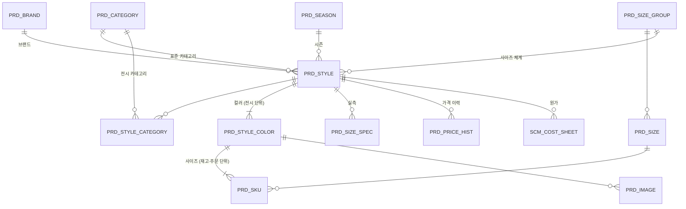
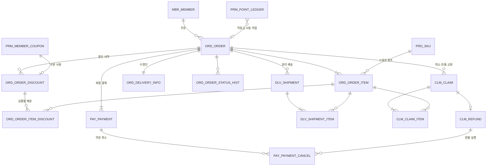
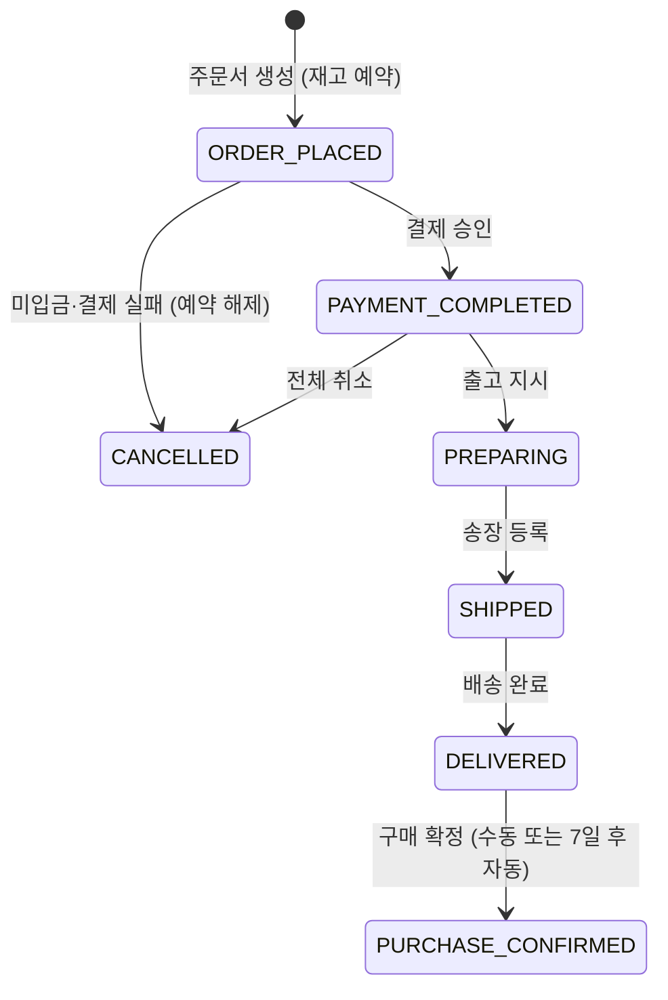
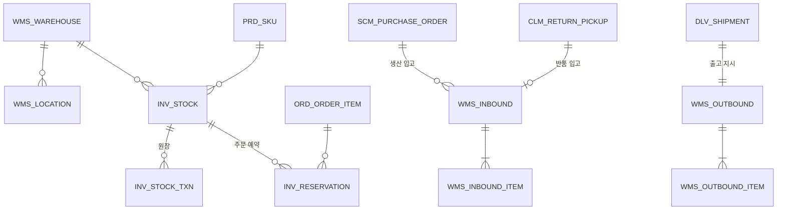
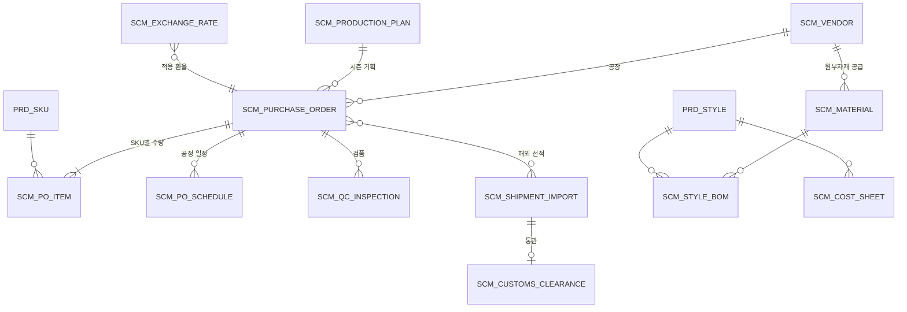

# 01. ERD 개요

도메인 간 관계와 핵심 엔티티 흐름을 정리한다. 컬럼 단위 정의는 도메인별 문서(`02_*.md`~)에서 다룬다.

## 1. 도메인 관계도

```mermaid
flowchart LR
    subgraph 고객
        MBR[회원 MBR]
        RVW[리뷰 RVW]
        CS[고객센터 CS]
    end
    subgraph 상품·전시
        PRD[상품 PRD]
        DSP[전시 DSP]
        PRM[프로모션 PRM]
    end
    subgraph 거래
        CRT[장바구니 CRT]
        ORD[주문 ORD]
        PAY[결제 PAY]
        CLM[클레임 CLM]
        DLV[배송 DLV]
    end
    subgraph 공급망
        SCM[생산·소싱 SCM]
        WMS[창고 WMS]
        INV[재고 INV]
    end
    subgraph 운영
        STL[정산 STL]
        ADM[관리자 ADM]
        SYS[로그 SYS]
    end

    MBR --> CRT --> ORD
    PRD --> CRT
    PRM --> ORD
    ORD --> PAY
    ORD --> DLV
    ORD --> CLM
    CLM --> PAY
    CLM --> INV
    INV --> DLV
    SCM --> WMS --> INV
    PRD --> SCM
    PRD --> INV
    DSP --> PRD
    ORD --> RVW
    MBR --> CS
    ORD & PAY & CLM & INV --> STL
    ADM --> SYS
```

## 2. 상품 구조 (패션 특화 3단)



| 단위 | 테이블 | 쓰임새 |
|---|---|---|
| 스타일(품번) | `PRD_STYLE` | 기획, 원가, 상품정보제공고시, 가격, 리뷰 묶음 |
| 컬러 | `PRD_STYLE_COLOR` | 상품 상세 페이지, 목록 노출, 이미지 |
| SKU | `PRD_SKU` | 장바구니, 주문, 재고, 발주, 바코드 |

## 3. 주문 → 결제 → 배송 → 클레임



> 계획 대비 변경: 할인의 상품별 배분을 정규화하려고 `ORD_ORDER_ITEM_DISCOUNT`를 추가했다. 주문 상품 행에는 배분 합계를 캐시 컬럼으로 함께 둔다.

**주문 상태 흐름**



- 부분 취소, 반품, 교환은 주문 상품 단위 상태(`ORD_ORDER_ITEM.ITEM_STATUS`)와 클레임으로 관리한다. 주문 헤더의 상태는 주문 상품 상태를 종합한 대표 상태다.

## 4. 재고 흐름



**재고 수량 정의 (`INV_STOCK`)**

| 컬럼 | 의미 | 변동 시점 |
|---|---|---|
| `ON_HAND_QTY` | 실물 재고 | 입고(+), 출고(−), 실사 조정(±) |
| `RESERVED_QTY` | 주문 예약 수량 | 주문 생성(+), 출고 또는 취소(−) |
| `AVAILABLE_QTY` | 판매 가능 수량 | `ON_HAND_QTY − RESERVED_QTY − SAFETY_QTY` (가상 컬럼) |

- `ON_HAND_QTY`는 언제든 `INV_STOCK_TXN` 원장 합계와 같아야 한다. 이 조건을 검증 쿼리로 확인한다.

## 5. 생산·소싱 (국내·해외)



> 계획 대비 변경: 발주 하나가 여러 번에 나눠 선적되고, 한 컨테이너에 여러 발주가 섞이기도 한다. 그래서 발주와 선적을 다대다로 연결하는 매핑 테이블 `SCM_IMPORT_PO`를 추가했다.

| 구분 | 국내 생산 | 해외 생산 |
|---|---|---|
| 통화 | KRW | USD 등 (외화) |
| 거래 조건 | 납품 | FOB / CIF (Incoterms) |
| 입고 경로 | 공장 → DC 직입고 | 공장 → 선적 → 보세창고 → 통관 → DC |
| 원가 구성 | 공임 + 원부자재 | FOB + 해상·항공 운임 + 관세 + 통관·내륙 운송비 |

## 6. 테이블 수 요약

| 도메인 | 테이블 수 | 도메인 | 테이블 수 |
|---|---|---|---|
| CMM 공통코드 | 2 | DLV 배송 | 5 |
| MBR 회원 | 11 | WMS/INV 재고·물류 | 11 |
| PRD 상품 | 15 | SCM 생산·소싱 | 14 |
| DSP 전시 | 4 | RVW 리뷰 | 3 |
| PRM 프로모션 | 7 | CS 고객센터 | 5 |
| CRT/ORD 주문 | 7 | STL 정산 | 5 |
| PAY 결제 | 4 | ADM/SYS 관리 | 8 (`ADM_ROLE_PERMISSION` 추가) |
| CLM 클레임 | 6 | **합계** | **약 107** |

## 7. 범위 가정 (확정 필요)

아래 항목은 현재 **미포함**으로 가정했다. 포함하기로 하면 해당 테이블을 추가한다.

| 항목 | 포함 시 추가할 것 |
|---|---|
| 오프라인 매장 POS 매출 | `ORD_ORDER.SALES_CHANNEL`에 `STORE` 추가, 매장 마스터, 매장 간 재고 이동 |
| 외부몰 입점 판매 (무신사, 29CM 등) | 채널 마스터, 외부 주문번호 매핑, 채널 수수료 정산 |
| 해외 판매 (역직구) | 다국어 상품명, 다통화 가격, 해외 배송·관부가세 |

※ 주문 테이블에는 처음부터 `SALES_CHANNEL` 컬럼을 두어, 나중에 범위를 넓혀도 구조를 바꾸지 않아도 되게 한다.
