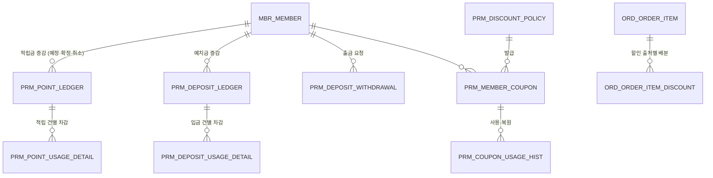
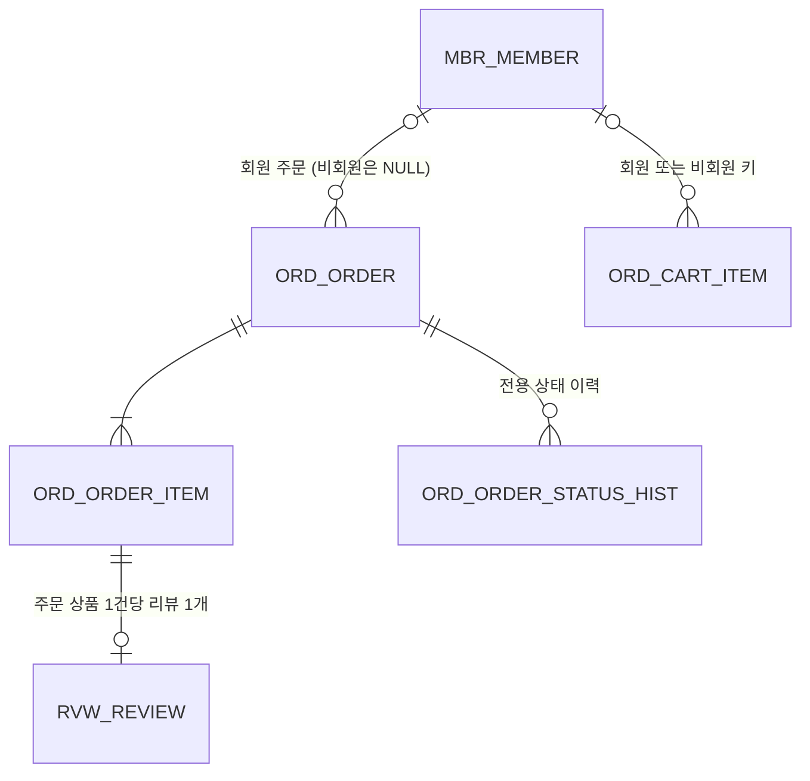
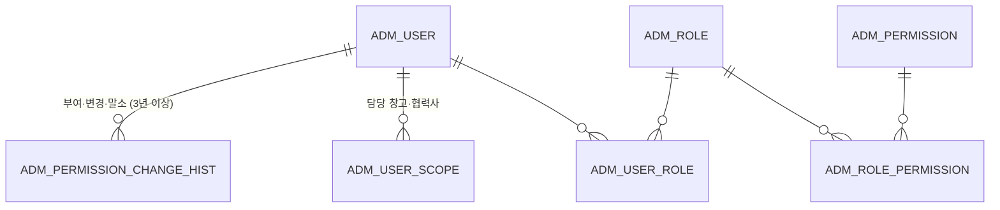

# 01. ERD 개요

> 기준일: 2026-11-21. 선행 결정 1~17번과 공통 결정을 반영했다.
> 테이블 이름은 `SYS_RESERVED_KEY`, `SYS_STATUS_HIST`, `SYS_PII_ARCHIVE`, `CMM_CODE_GROUP`, `CMM_CODE`를 제외하고 모두 **후보**다. 각 도메인 결정 단계에서 확정한다.
> 컬럼 단위 정의와 도메인별 상세 ERD는 도메인 결정 후 작성한다.

## 1. 도메인 관계도

```mermaid
flowchart LR
    subgraph 고객
        MBR[회원 MBR]
        RVW[리뷰 RVW]
        CS[고객센터 CS]
    end
    subgraph 상품·전시
        PRD[상품 PRD]
        DSP[전시 DSP]
        PRM[프로모션 PRM]
    end
    subgraph 거래
        ORD[주문 ORD<br/>장바구니 포함]
        PAY[결제 PAY]
        CLM[클레임 CLM]
        DLV[배송 DLV]
    end
    subgraph 공급망
        SCM[생산·소싱 SCM]
        WMS[창고 WMS]
        INV[재고 INV]
    end
    subgraph 운영
        STL[정산 STL]
        ADM[관리자 ADM]
        SYS[시스템 SYS]
        NTF[알림 NTF]
        BAT[배치 BAT]
    end

    MBR --> ORD
    PRD --> ORD
    PRM --> ORD
    ORD --> PAY
    ORD --> DLV
    ORD --> CLM
    CLM --> PAY
    CLM --> INV
    INV --> DLV
    SCM --> WMS --> INV
    PRD --> SCM
    PRD --> INV
    DSP --> PRD
    ORD --> RVW
    MBR --> CS
    ORD & PAY & CLM & INV --> STL
    MBR & ORD & PRM --> NTF
    BAT --> NTF
    ADM --> SYS
```

- 비회원 주문을 허용하므로 `MBR → ORD` 관계는 선택적이다 (주문 `MEMBER_ID` NULL 허용, 14-1 C).

## 2. 선행 결정으로 정해진 핵심 구조

### 2-1. 적립금·예치금·쿠폰 (15번)



- 원장은 수정·삭제하지 않고 반대 금액 행으로 정정한다.
- 예치금 테이블의 접두어(`PRM` 또는 `PAY`)는 미확정이다.
- 환불 계좌는 회원 테이블 컬럼이다 (15-3-3 가).

### 2-2. 주문·비회원 (14번)



- 주문: 주문자 스냅샷(휴대폰·상세 주소 등 일부 암호화, 이름·도로명/지번 주소는 평문 + TDE (선행 5-1 변경, 회원 컬럼 검토 C-72). 범위는 주문 도메인에서 정함), 비회원 비밀번호 해시, 주문자 휴대폰 HMAC 해시, 판매 채널 + OS, UTM 컬럼.
- 장바구니: `MEMBER_ID`와 비회원 장바구니 키 중 정확히 하나 (CHECK).

### 2-3. 관리자 권한 (16번)



- 회원 테이블과 분리하고, 외부 사용자 계정은 두지 않는다.

### 2-4. 시스템·배치·알림 (6, 9~13번)

| 영역 | 후보 테이블 |
|---|---|
| 범용 (확정) | `SYS_STATUS_HIST`, `SYS_PII_ARCHIVE`, `SYS_RESERVED_KEY` |
| 감사 로그 (용도별) | `SYS_PII_ACCESS_LOG`, `SYS_ADMIN_ACTION_LOG`, `SYS_DATA_CHANGE_LOG` |
| Redis 대체 | `SYS_VERIFICATION_CODE`, `SYS_IDEMPOTENCY_KEY`, `MBR_REFRESH_TOKEN`, `MBR_RECENTLY_VIEWED_ITEM` |
| 앱·분석·외부 업체 | `SYS_APP_VERSION`, `SYS_SEARCH_KEYWORD_LOG`, `SYS_EXTERNAL_VENDOR` |
| 외부 연동 로그 | `PAY_PG_INTERFACE_LOG`, `DLV_COURIER_INTERFACE_LOG`, `MBR_IDENTITY_VERIFICATION_LOG` |
| 알림 | `NTF_SEND_HIST` |
| 배치 | `BAT_JOB_RUN_HIST`, `BAT_JOB_LOCK` |

## 3. 테이블 수 요약 [후보]

| 도메인 | 수 | 도메인 | 수 |
|---|---|---|---|
| CMM 공통코드 | 2 | WMS 창고 | 3 |
| MBR 회원 | 10 | INV 재고 | 2 |
| PRD 상품 | 10 | SCM 생산·소싱 | 7 |
| DSP 전시 | 3 | RVW 리뷰 | 2 |
| PRM 프로모션 | 9 | CS 고객센터 | 3 |
| ORD 주문 | 5 | STL 정산 | 3 |
| PAY 결제 | 3 | ADM 관리자 | 7 |
| CLM 클레임 | 3 | SYS 시스템 | 11 |
| DLV 배송 | 3 | NTF 알림 / BAT 배치 | 1 / 2 |
| | | **합계** | **89** |

- 전체 목록은 `docs/pdf/후보테이블/후보테이블_목록.pdf`에 있다.
- 회원 외 도메인은 패턴 검토 전이라 도메인 결정 단계에서 바뀔 수 있다.

## 4. 범위 [확정]

| 항목 | 결정 |
|---|---|
| 오프라인 매장, 외부몰 입점, 해외 판매 | 제외 |
| 판매 채널 | 자사몰 `PC`, `MOBILE_WEB`, `APP` + OS 컬럼 (10-1 C) |
| 통화 | 판매는 원화만, 외화는 생산·소싱에서만 |
| 창고 | 국내 DC, 반품센터, 보세창고 |
